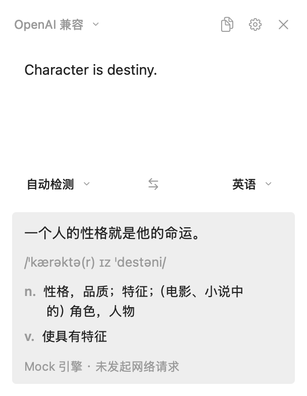

# Peek

macOS 浮窗翻译器。纯 AppKit 手写，无第三方依赖、无 Xcode 工程、无 Storyboard，全部代码建视图。

交互模型参考了 Bob 0.2.0 的公开界面行为（无边框非激活浮窗 + 贴鼠标出现 + 结果区三态），代码从零实现，没抄一行。
目标不是做成品，是给一个**可以往里塞自己东西的壳**，而且这个壳在「快 / 丝滑 / 占用少」三项上有可复现的数字。

能力：输入翻译、划词翻译、剪贴板翻译、截图（复制 / 保存 / 识别）、截图翻译、原文与译文各自一键复制、最近 10 条剪贴板历史、Mac 本地离线翻译、任意 OpenAI 兼容接口。



---

## 跑起来

需要 macOS 13+ 和命令行工具（`xcode-select --install`），不需要完整 Xcode。

```bash
./build.sh              # 编译 + 打包 dist/Peek.app
open dist/Peek.app

./install.sh            # 或者一步到位：装到 /Applications 并重启
```

`build.sh` 会把当前提交和构建时间写进 `Info.plist`（`PeekBuildCommit` / `PeekBuildTime`），启动日志和「设置 → 关于」都能看到，形如 `版本 0.1.5 · cef4663+`。末尾的 `+` 表示编进包里的代码有未提交改动。改完代码不确定装上去的是不是新包时，看这一行比比对时间戳可靠。

**没有自动更新**。这个项目靠源码构建分发，不提供预编译包 —— `git pull && ./install.sh` 就是更新，而且这比自动更新更可控（签名证书不变，辅助功能与屏幕录制的授权也不会掉）。

首次启动会自动弹设置面板。**没有任何配置也能直接开始**：点「还没有 Key？免费注册 →」，向导带你选服务商、打开注册页、粘贴 Key、自动校验额度，完事直接进模型列表挑一个。完全不想联网就切到「离线翻译」（用 macOS 自带模型）或「Mock」。

**热键**

下表是默认值，全部可以在「设置 → 快捷键」里改：点键位框，按下新的组合键即可，`⌫` 清除绑定，`Esc` 取消。组合键至少要带 `⌘`、`⌥`、`⌃` 之一。

| 快捷键   | 行为                 |
| ----- | ------------------ |
| `⌥A`  | 打开输入框（保留上次内容）      |
| `⌥D`  | 划词翻译：取当前选中文本，直接出结果 |
| `⌥V`  | 翻译剪贴板（不需要任何权限）     |
| `⌥Z`  | 剪贴板历史：最近 10 条，点一条放回剪贴板 |
| `⌥S`  | 截图翻译：拖框 → OCR → 翻译 |
| `⌥X`  | 截图：拖框 → 缩略图窗，再决定复制 / 保存 / 识别 |
| `⌥⇧D` | 显示 / 隐藏切换          |

键位存在 `UserDefaults` 的 `hotkeys.v1` 下，改完点「保存」即时生效，不用重启。两个动作不能绑同一个组合键。

`Enter` 翻译，`⇧Enter` 换行，`Esc` 关闭，`⌘Enter` 强制重译。点面板外面自动收起。

面板右上角的图钉按下后，点外面不再收起，适合对照原文慢慢改、或者拿面板当参照看别的窗口。钉住状态只在本次显示期间有效，收起后再唤起回到默认。原文区和译文区各有一个复制按钮，只复制对应那一半。

截图时 `Esc` / 右键 / 点一下不拖（< 4pt）都取消。

缩略图窗里：`⌘C` 复制、`⌘S` 保存、`⏎` 识别文字，双击缩略图直接复制，点窗口外面或 `Esc` 收起。

**剪贴板历史**（`⌥Z`）：列出最近 10 条复制过的文本，最新在上。点一条即写回剪贴板并关窗，接着 `⌘V` 就能粘；`↑↓` 选、`⏎` 复制、`1`–`9` 直选、`Esc` 关，点窗口外面也收起。

- 只收**纯文本**，图片和文件不记录 —— 落盘体积不可控，而「复制一段话」才是高频场景
- 带 `org.nspasteboard.ConcealedType` 标记的跳过，那是密码管理器在声明「别记我」
- 存在 `~/Library/Application Support/Peek/clipboard-history.json`，文件权限 `0600`
- 菜单栏可以关掉记录（已有条目保留），也可以一键清空
- AppKit 没有剪贴板变更通知，靠轮询 `NSPasteboard.changeCount`（0.4s）：没变化时只读一个整数，变了才取内容

**权限**：`⌥D` 要辅助功能，`⌥S` / `⌥A` / `⌥X` 要屏幕录制。第一次触发时会弹系统授权框，勾完最好重启一次 App。

**签名（可选，但强烈建议）**

```bash
./tools/signing/make_cert.sh    # 生成 "Peek Local Signing" 自签证书并导入独立钥匙串
./install.sh                    # 之后每次构建都用它签
```

为什么要这么麻烦：辅助功能/屏幕录制这类 TCC 授权是绑在代码签名上的。不签名（或 ad-hoc 签名）时系统只能拿 cdhash 认人，
**每次重编译 cdhash 就变，之前勾的授权立刻作废** —— 表现就是"设置里明明勾着，功能就是不工作"，非常费解。
换成固定证书后，签名要求变成 `identifier "com.peek.translator" and certificate leaf = H"…"`，只跟证书走，重编多少次授权都在。

没有证书也能跑，`build.sh` 会退化成 ad-hoc 签名。

**隐私**：翻译内容只发给你自己配置的服务商（OpenAI 兼容接口）；选「离线翻译」则完全不出本机。
API Key 明文存在 `~/Library/Preferences/com.peek.translator.plist` —— 和同类工具一样的做法，介意就自己换成 Keychain。

---

## 接自己的引擎

两种方式，取决于改动范围。

### 1. 只是换接口地址

打开设置，填：

```
Base URL   https://your-gateway/v1        # 会自动补 /chat/completions
API Key    sk-xxx                          # 本地服务可留空
模型        qwen2.5-7b-instruct
系统提示词  留空则用内置翻译 prompt
```

走的是 OpenAI Chat Completions 协议。vLLM / One-API / Ollama / 内部网关都通。响应解析对 `content` 是字符串还是分段数组都做了兼容。

翻译本身也是大模型任务，不是传统翻译 API —— 发给模型的是「系统提示词 + 目标语言 + 原文」，模型返回译文。所以任何能聊天的模型都能拿来翻译。

### 0. 用 macOS 自带的翻译（新增）

顶栏引擎下拉里选**系统翻译（离线）**，不需要钥匙、不需要联网，译文不出本机。

用的是 `Translation.framework`，系统支持 21 种语言（中英日韩法德西俄葡意荷波土泰越印尼阿乌…），我们的语言列表全部覆盖。

三个需要知道的事实：

- **语言包要单独下载**。系统不预装，首次翻译某个语言对时苹果会弹窗问你要不要下载（几百 MB）。也可以在「系统设置 → 通用 → 语言与地区 → 翻译语言」里提前装好，之后完全离线。
- **不能自己 new session**。手动 `TranslationSession(installedSource:target:)` 出来的对象 `canRequestDownloads == false`，语言包没装时只会得到 `Unable to Translate`。只有 SwiftUI `.translationTask` 回调里拿到的 session 才有下载权限 —— 所以工程里挂了一个 1×1 透明窗口专门用来取 session，这部分在 `SystemTranslateEngine.swift` 里有注释。
- **译文风格更直译**。系统模型偏"字面对应"，长句和口语不如大模型自然；要润色还是接 LLM。

### 检测可用模型

设置里点**「浏览可用模型…」**，会拉当前 Base URL 的 `/models`，并对每个**免费**模型发一次真实请求确认能不能调通（不是只看列表里有没有名字）。

判定规则：

- 免费看 `pricing.prompt == 0 && pricing.completion == 0`，不看名字里的 `:free` —— 名字会变，价格字段不会
- 输出模态含 `audio` / `image` 的生成类模型剔除（Lyria 标价也是 0，但它是写歌的）
- 按命名排除 embedding / tts / moderation / rerank 这类确定不做对话的模型
- 探测用 `max_tokens=1` 的最小请求，结果分五档：`✓ 可用`（带延迟）/ `! 仅推理` / `! 限流` / `✕ 无权` / `✕ 不可用`

两个刻意的设计：

- **只自动探测免费模型**。付费模型要你点「检测可用性」并确认一次，不会替你花钱
- **并发 2**。OpenRouter 免费池限 20 次/分，并发拉满必然 429

2026-11 实测：OpenRouter 431 个可对话模型，14 个免费。

**适合翻译的**

| 模型 | 上下文 | 理由 |
|---|---|---|
| `google/gemma-4-26b-a4b-it:free` | 262K | **首选**。MoE 25.2B 总参但只激活 3.8B，延迟低，多语言训练充分 |
| `nvidia/nemotron-3.5-lightning:free` | 1M | 3B active / 30B 总参，这批里最快的一个 |
| `xingchen-agi/xing4.0-29b-a4b:free` | 262K | 中国电信 TeleAI，中文语感好 |
| `thinkingmachines/inkling-small:free` | 1M | 主打多语言对话，通用能力均衡 |

**不适合的**（检测结果里会有，但别选）

- `recursive/flint-v1.0:free`、`cohere/north-mini-code:free` —— coding 专项
- `nvidia/nemotron-3.5-content-safety:free` —— 内容安全分类模型，不产出译文
- `liquid/lfm-2.5-2.6b:free` —— 2.6B 太小，长句容易断
- `google/lyria-*` —— 音乐生成，已经过滤掉

**额度和注意**

- 免费账号：**50 次/天、20 次/分**；充值 $10 后提到 1000 次/天（这 $10 不过期）
- 失败请求照样扣额度，别写重试循环
- **部分免费模型明确说明会用你的输入输出训练**。翻译内部资料、代码、未公开文档时，别用免费池
- 免费端点的上下文有时比同名付费端点小，长文本会被截

### 注册向导

设置里点「还没有 Key？免费注册 →」，三步走完：

1. **选服务商** —— OpenRouter（有免费额度）/ 硅基流动（国内直连）/ DeepSeek（按量计费）/ 自定义
2. **创建 Key** —— 按钮直接打开注册页和密钥页，粘贴回来
3. **校验** —— OpenRouter 走 `GET /api/v1/key`，能读到 Key 名称、已用额度、上限、限流；其他服务商先列模型，再拿第一个可对话模型试调一次

校验通过后自动回填 Base URL 和 Key，落盘，然后直接打开模型浏览器，不需要再点一次保存。

### 2. 完全自定义

实现 `TranslateEngine`，在 `EngineRegistry.makeAll()` 里登记一行：

```swift
final class MyEngine: TranslateEngine {
    let id = "mine"
    let displayName = "内部引擎"
    let requiresConfiguration = false

    func translate(_ text: String, from: Language, to: Language) async throws -> TranslateOutput {
        // 你的请求
        return TranslateOutput(translation: "译文")
    }
}
```

`TranslateOutput` 支持 `phonetics` / `senses` / `note` —— 有 `senses` 时结果区会自动切成词典排版（词性 + 释义 + 悬挂缩进）。不填就只显示一段译文。

零新增 UI 代码，顶部引擎下拉会自动出现新条目。

---

## 截图取词与 OCR

`⌥S` 拉出全屏遮罩：`CGDisplayCreateImage` **只抓一次**冻结画面，之后拖框不再重复抓屏（这是能跟手的前提）。
遮罩上挖出选区透明洞、1.5pt 蓝框、左上角 `380 × 200` 尺寸标签，光标旁跟一个 8× 放大镜（靠边自动翻到另一侧）。
`⌥S` 出译文，`⌥A` 只出识别结果并写剪贴板。

`⌥X` 是纯截图，和上面两条共用同一套遮罩与裁剪，区别只在框完之后：不直接跑 OCR，
而是弹一个缩略图窗（图 + 尺寸 + 字节数），下面三个按钮——复制到剪贴板、保存成 PNG、识别文字。
保存走标准存储面板，默认落在桌面；识别则交回主面板，走和 `⌥A` 完全相同的路径。
这个窗口是 `nonactivatingPanel`，不会激活 App；关掉时把焦点还给框选前那个应用。

识别走 Vision `VNRecognizeTextRequest`：`.accurate` + `usesLanguageCorrection` +
`recognitionLanguages ["zh-Hans", "en-US"]` + **关闭** `automaticallyDetectsLanguage`（开了会忽略我们指定的顺序，小号中文掉得厉害）。

**预处理：为什么要两路都跑**

Vision 对输入像素密度很敏感，小框截出来的字（一行十几 px）会整行漏掉。所以识别前会做一轮预处理：
转灰度 → 深底浅字自动反色 → 动态范围不足时按 2%/98% 百分位拉伸 → 小图放大（短边 < 200 用 3×，< 700 用 2×）。

但实测增强**不是稳赢**：

| 样本 | 原图 | 增强 |
| --- | --- | --- |
| 340×96 深底小字 | 2 行（第三行整行漏） | **3 行全出** |
| 460×120 等宽终端绿字 | **`load_checkpoint` / `latency` 全对** | `1oad_checkpoint` / `8.93` |
| 680×192 中文小字 | 3 行，`YOLO +GPU` 缺空格 | 3 行，`YOLO + GPU` |

也就是说：**放大能补回漏行，却会把等宽字体的 `l` 磨成 `1`**。而 Vision 的置信度不能当裁判 ——
终端那组增强版置信度 0.50 高于原图 0.43，内容却更差。

所以 `Enhance.auto` 的做法是**两路都跑，按行数选优**：行数多的赢，行数打平用原图。
漏一整行的代价远大于错一个字母（漏行丢信息，错字母多数能被翻译模型纠正）。
热态下两路合计 130~170ms；整屏大图且原图置信度 ≥ 0.7 时跳过增强，省一次几百毫秒。

**行聚类**：按纵向重叠 > 较小行高的一半归行，行内按 x 排序。早先按 `maxY` 取整分桶，
同一行的两段文字（`UNet子` / `图`）会因为 maxY 差一点被劈成两行，已改。

**预热**：Vision 首次调用要加载模型，实测冷启动 **13~14 秒**、热态 100~200ms。启动 1 秒后后台跑一次真识别，
之后第一次截图不用等。预热图是一张 900×220 的合成文字图。预热成功后启动「保活」——
每 20 分钟轻点一次模型，避免长时间闲置后模型页被系统回收。

**`CRImageReaderError error 1` 的真正原因（2026-11-14 定位，推翻了上一版结论）**

报错本身是 `e5rt_execution_stream_operation_create... failed`，但它跟输入图格式**没关系**，是**进程环境**的问题：

- **GUI 进程**在模型冷加载（实测 13.6 秒）之后，视觉计算路径进入不可恢复状态 ——
  CPU / 默认 / GPU 三个计算设备**全部**失败，进程内没有任何 API 能重置它；
- 同一时刻、同一份代码、同样的冷加载，**命令行进程**（`Peek --verify-ocr`）却能正常识别
  （14.2 秒冷加载后成功一次）。差异就在「创不创建 `NSApplication`」这一步。

复现特征很好认：进程启动时预热耗时 **13 秒以上**（说明模型页被系统回收过）→ 之后每次识别都失败；
热态启动（预热 200 ms~1 s）则一切正常。16 GB 机器闲置一夜后几乎必然如此，
因为模型页会被系统回收，重加载时这条路径就坏了。

对策分三层：

1. **`normalize()`** 把输入统一成 8-bit / 32bpp / BGRA 预乘 / DeviceRGB ——
   格式频繁变化确实会额外触发失败，所以这条保留，但它不是根因；
2. **保活**：预热成功后每 20 分钟做一次空识别，让模型页保持活跃、不被当成冷页回收；
3. **独立进程兜底**：本进程识别失败后自动切到 `Peek --ocr-server` ——
   同一个二进制的命令行模式，`main.swift` 第一行就分流，绝不创建 `NSApplication`。
   实测独立进程 59~83 ms 返回（比主进程热态还快）；它要是也坏了会被杀掉重来，
   这是唯一能自愈的做法。主进程那边会记 5 分钟降级，期间直接走独立进程，不再浪费 0.7 秒试三个注定失败的设备。

另外计算设备默认改成 **CPU**（`PEEK_OCR_DEVICE=cpu|gpu|ane|default` 可改）：实测 CPU 比默认的 ANE 快一倍
（83 ms vs 174 ms），也不依赖睡眠时会断电的 ANE 上下文。

排查开关：`PEEK_OCR_FORCE_BRIDGE=1` 强制一律走独立进程；`PEEK_OCR_DEVICE` 换设备。

**自检**

```bash
Peek --verify-ocr 图.png              # 按 auto 策略识别
Peek --verify-ocr 图.png --compare    # 原图 / 强制增强 / auto 三路并排
Peek --verify-ocr 图.png --matrix     # 增强但分别用 1× / 2× / 3× 放大，用来定倍数
Peek --verify-capture                  # 抓屏与裁剪
swift tools/make_ocr_fixtures.swift build/ocr-fixtures   # 生成四类对照样本（各 1x / 2x）
```

---

## 三个硬指标

| 指标              | 本 demo    | Bob 0.10.3 | 做法                        |
| --------------- | --------- | ---------- | ------------------------- |
| 物理占用（默认，含 Vision 模型） | **39–53 MB** | 77 MB      | 预热面板、单 TextView 渲染、动态色零订阅 |
| 物理占用（关掉 OCR 预热）  | **19 MB** | —          | 同上                        |
| 空闲 CPU          | **0.01–0.03%** | 0.00%      | Carbon 热键；唯一的周期任务是 0.4s 剪贴板轮询 |
| 热键到首帧           | 未测（见下）    | —          | 窗口常驻 + 零视图构建              |

> **OCR 预热是最大的一块**：19 MB → 39~53 MB（系统会回收一部分模型页，热机 39、冷机 53），加载瞬间峰值 77~84 MB。
> 菜单栏 →「启动时预热 OCR」可以关掉；关掉后首次截图要等模型加载（冷机实测 15 秒，系统缓存热了 170 ms）。
> 关掉「记录剪贴板历史」会连轮询 Timer 一起停，空闲 CPU 从 0.028% 降到 0.014%。

复现：

```bash
footprint -p $(pgrep Peek)                       # 53 MB（默认，预热已跑完）
defaults write com.peek.translator prewarmOCR -bool NO   # 重启后 19 MB
```

怎么省下来的：

1. **窗口在启动时就建好**，之后每次唤起只做两次字符串赋值 + `orderFront`。零窗口创建、零视图构建、零约束求解。
2. **布局全部手写 frame**，不用 Auto Layout。改高度不走约束求解器，直接算。
3. **结果区是单个 NSTextView + 属性字符串**。Bob 0.2.0 的 `WordResultView` 每次翻译 `removeFromSuperview` 再逐个重建 `NSTextField` + Masonry 约束，一个词约 20 个视图 20 套约束 —— 那是最主要的卡顿来源。
4. **无动画、无模糊材质**。全仓库没有 `NSAnimationContext`，没有 `NSVisualEffectView`。圆角靠 `layer.cornerRadius` 一次设置，阴影交给系统窗口。
5. **配色是动态 NSColor，不订阅任何通知**。Bob 0.2.0 的 `DarkModeManager` 每调一次 `excuteLight:drak:` 就起一个 RAC 订阅且不释放，窗口反复创建会累积。
6. **热键走 Carbon** `RegisterEventHotKey`，系统回调，不轮询。
7. **全局鼠标监听只在面板可见期间挂载**，隐藏即移除。Bob 0.2.0 是常驻的，别的 App 每次点击都会回调进进程。
8. **文本高度用临时 TextKit 栈测量**，只 layout 不渲染，测量栈全局复用一份。
9. **窗口关掉就拆掉**。设置窗、模型列表窗 `orderOut` 之后顺手把 `contentView` 拆了、页面数组清空，不把整棵视图树挂到退出（重复开关十轮内存不涨）。代价是下次打开多几十毫秒重建。
10. **日志封顶 1 MB**、剪贴板落盘走后台串行队列。前者防日志无限长（每复制一条写一行），后者让主线程不碰磁盘。

---

## 尺寸规格

全部 12pt 栅格，改 `Metrics` 一处即可整体换算。

```
宽 304 = 12 + 280 + 12

┌─ 12 ────────────────────────────────┐
│ topBar            24                │  引擎名 · 复制 · 设置 · 关闭
│         ↕ 10                        │
│ 白卡              154               │  6 + 110(查询) + 8 + 24(语言行) + 6
│         ↕ 10                        │
│ 结果区            116 ~ 500         │  超出 500 内部滚动
│         ↕ 12                        │
└─────────────────────────────────────┘
```

窗口高度 = 222 + 结果区高度。改高度时锚点是左下角，必须先记 `topLeft` 再补回，否则窗口会往上窜 —— 这是原版踩过的坑，代码里 `relayout` 有注释。

---

## 已验证 / 未做

**已验证**（`Peek --verify`）：

```
PASS  面板预热 304x338
PASS  固定区高度 222 / 结果区 min 116
PASS  热键 ⌥F 注册
PASS  面板显示
PASS  翻译返回（Mock 引擎完整 async 链路，117 字符）
PASS  结果展开 338 → 411
PASS  高度上限
```

HTTP 链路用本地假服务跑通过端到端（`tools/mock_openai_server.py`），错误路径也验过（连接失败会显示「网络请求失败」+ 可点的「打开设置」）。目录与探测也实跑过：
- `--verify-catalog` 真实请求 OpenRouter，2026-11-03 返回 431 个可对话模型 / 14 个免费
- `--verify-probe` 对本地假网关跑通了全部判定分支：`✓ 可用` / `! 仅推理` / `✕ 无权`，embedding 被正确过滤
- 真实窗口跑过自动探测：日志确认只对 3 个免费模型发了请求，付费模型一次没碰
- 系统翻译（`--verify-system`）：en↔zh 语言包装好后走 `TranslationSession(installedSource:target:)` 直连，
  `en→zh → 你好，世界`、`auto→zh → 早上好，你今天过得怎么样？` 均通过；缺包时走隐藏窗口取 session 拉系统下载框
- 截图链路（日志来自真实 GUI 进程）：`188×143px → "Bobkit / ChatGPT" → "Bobkit聊天GPT"`；`348×140px → 3 行中文技术句`
- OCR 预处理对照（`--verify-ocr --matrix`，四类样本各 1x/2x）：原图在深底小字上整行漏（2 行），增强 3 行全出；
  等宽终端字则相反（原图全对，增强把 `l` 磨成 `1`）—— 这就是 `auto` 按行数选优的依据

**粘贴（`--verify-paste`）**：主菜单里 `粘贴 = ⌘V` 存在；窗口层 `performKeyEquivalent` 处理 ⌘V 后内容确实进了 Key 输入框；查询浮窗同样通过；底层 `paste:` 能送达字段编辑器。

> 这里踩过一个坑：纯代码启动的 AppKit 应用如果没有 `NSApp.mainMenu`，`⌘V / ⌘C / ⌘A / ⌘Z` 全部失效 —— 这些快捷键不是控件自己处理的，而是 `NSApplication` 交给主菜单做 key equivalent 匹配后再沿响应链发 `paste:` 等 action。表现就是"能打字，但按 ⌘V 毫无反应"。现在 `MainMenu.install()` 装了最小编辑菜单，窗口层再兜一层，两条路都覆盖。

**没做**（按需再加）：

- 多窗口（同一时间只有一个浮窗；面板可以钉住不收起，但不能再开第二个）
- 插件系统（JS 脚本宿主）
- 剪贴板历史只收文本，图片和文件还没做（要做的话得考虑缩略图与体积上限）
- OCR 的版面分析（现在按行 + 纵向重叠归并，表格、多栏会串行）

**一个已知取舍**：`⌥D` 取词先走 AX 直读（`kAXSelectedText`），不碰剪贴板；
读不到才退「等修饰键抬起 → 模拟 ⌘C → 轮询 changeCount」，最多等 250ms。退路会覆盖剪贴板，
但只在真取到词时才写，取不到不动。不走纯 AX 是因为不少 Electron / 自绘控件不暴露 `kAXSelectedText`。

---

## 代码结构

```
Sources/Peek/
├── main.swift              入口，含 --snapshot / --verify 无头模式
├── AppDelegate.swift       预热、热键注册、首次配置引导
├── PanelController.swift   核心：状态机、手写布局、翻译调度
├── FloatingPanel.swift     NSPanel 子类（nonactivating + borderless）
├── MainMenu.swift          主菜单 + 编辑快捷键兜底（没有它 ⌘V 不工作）
├── QueryEditor.swift       输入框（自己接管 ⌘V/⌘A/⌘C/⌘Z）
├── ResultView.swift        结果区（单 TextView + 属性串构造）
├── MenuControl.swift       自绘下拉（文字与箭头紧排）
├── CardView.swift          圆角卡片
├── Theme.swift             配色与字体
├── Config.swift            尺寸常量与偏好键
├── HotKey.swift            Carbon 热键（注册 / 注销）
├── SelectionGrabber.swift  划词取词（AX 直读 → 模拟 ⌘C 兜底）
├── ScreenCapture.swift     抓屏冻结帧 + 像素裁剪
├── ScreenshotOverlay.swift 框选遮罩（挖洞 / 蓝框 / 尺寸标签 / 8× 放大镜）
├── CaptureResult.swift     截图缩略图窗（复制 / 保存 / 识别）
├── ClipboardHistory.swift  剪贴板历史（轮询 changeCount、只收文本、落盘 0600）
├── ClipboardHistoryWindow.swift  ⌥Z 历史小窗（键盘导航 + 点击写回）
├── OCR.swift               Vision 识别 + 行聚类 + 预处理与两路选优
├── HotKeySpec.swift        快捷键动作定义、默认值、持久化与键名格式化
├── SettingsWindow.swift    设置面板（左侧分类：引擎 / 快捷键 / 通用 / 关于）
├── ModelBrowserWindow.swift  模型列表 + 可用性探测（NSTableView）
├── SignupWizard.swift      注册向导（三步）
├── StatusItemController.swift  菜单栏
├── TextMetrics.swift       高度测量栈
├── Diagnostics.swift       日志落 ~/Library/Logs/Peek.log
├── Snapshot.swift          离线渲染
├── Verify.swift            自检
├── VerifyOCR.swift         OCR / 抓屏自检（--compare / --matrix）
└── Engine/
    ├── TranslateEngine.swift   协议 + 数据模型 + 注册表
    ├── SystemTranslateEngine.swift  macOS 自带翻译（Translation.framework + 隐藏承载窗口）
    ├── OpenAICompatEngine.swift
    ├── ModelCatalog.swift      /models 拉取与过滤
    ├── ModelProbe.swift        单模型可用性探测
    ├── KeyVerifier.swift       Key 校验与额度查询
    └── MockEngine.swift
```

无头调试：

```bash
.build/release/Peek --verify                              # 逻辑自检
.build/release/Peek --verify-paste                        # 粘贴链路（⌘V）
.build/release/Peek --verify-system                       # 系统翻译：支持语言 + 语言包状态
.build/release/Peek --verify-system --download            # 真的触发语言包下载（会弹系统框）
.build/release/Peek --snapshot /tmp/a.png                 # 渲染成图
.build/release/Peek --snapshot /tmp/b.png --dark          # 暗色
.build/release/Peek --snapshot-settings /tmp/s.png        # 渲染设置窗口
.build/release/Peek --snapshot-settings /tmp/k.png --page 1  # 1 快捷键 / 2 通用 / 3 关于
.build/release/Peek --snapshot-history /tmp/h.png         # 渲染剪贴板历史小窗
.build/release/Peek --snapshot-models /tmp/m.png          # 渲染模型列表
.build/release/Peek --snapshot-signup /tmp/w.png --step 1 # 渲染注册向导
.build/release/Peek --verify-catalog                      # 拉一次 OpenRouter 模型目录
.build/release/Peek --verify-probe <baseURL> --limit 5    # 探测前 5 个模型的可用性
.build/release/Peek --open-models <baseURL> --seconds 6   # 真实窗口跑一遍自动探测
.build/release/Peek --verify-http http://127.0.0.1:18923/v1
.build/release/Peek --verify-ocr 图.png --compare          # OCR：原图 / 增强 / auto 三路对照
.build/release/Peek --verify-capture                       # 抓屏 + 裁剪
```

---

## 关于授权

Peek 与 Bob（`ripperhe/Bob`）的作者、发布方没有任何关系，也**没有使用它的任何代码**。

参考的只有 Bob 0.2.0 公开可读的界面尺寸与交互模式（源码 `archive_0.2.0/` 里没有 LICENSE，处于「源码公开但未授权」状态，
所以本工程按「只读参考、重新实现」处理）。图标、名称、实现均为独立产出。

本项目自身用 MIT 许可证，见 [LICENSE](LICENSE)。
